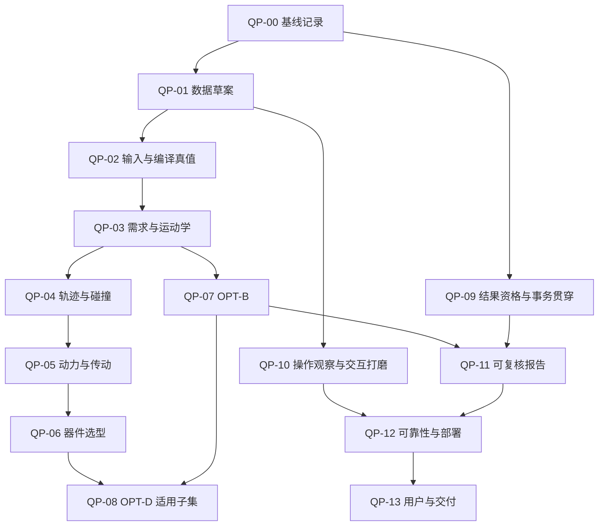

# 工程打磨工作包与推进台账

> 执行说明：使用 superpowers:executing-plans 按工作项推进；本文件不授权新建会话、委派子智能体或自动合入。产品修改进入现有 canonical 契约后，执行实施→独立验收→所有者合入流程。复选框记录本计划工作项完成证据，不代替契约状态。

**目标**：以已有六轴机械臂改型与选型为贯穿案例，将工程打磨分成可分派、可验证、可追踪的交付包。

**架构**：沿用 20 单元、既有六类端口和唯一权威；工作包跨单元组织研发任务，修复在各单元 canonical 契约内实施。保持不可变修订、快照与证据语义。

**技术栈**：C++17、MSVC 2022 x64、Qt Widgets、RobWork/RobWorkStudio/RobWorkSim、vcpkg、GoogleTest、PowerShell。

日期：2026-10-15；版本：1.1；性质：已建立的管理拆分与初始台账，产品完成状态以任务契约及验收证据为准。

## 1. 编号、现况和管理边界

本文件是 `development-task-breakdown.md`（DTB）§0.4 登记的工程打磨管理视图。**QP-00～QP-13 是工作包定位标签，不是新主 WP、不是 canonical taskId、不是新执行队列**；`QP-xx.01～04` 只是本页工作项定位键。每包映射既有 WP-A～WP-I；新增产品修复须在 DTB §2 的对应 WP 下取后继号，登记单元卡并建立 `tasks/foundation/*.json`。不新造 WP-26，不重开已 done 的原始任务，不修改现有里程碑定义。

本次入口只读核验基线为 `redesign-main@7ce545e3215cab7c711f5bb50148ff49aa3f8639`。后续每次运行记录实际 40 位 SHA，不能将本文 SHA 当作永久基线。

已观察到的现况（不等于本次重新验收通过）：

- 任务文件共 350 份；文档治理检查在拆分前通过，20 单元、12 条 trace entry。
- OPT-B：WP-20-T02～T11 均登记 done，包括预检、基线、Pareto、分层评估、采用、导出、插件与黄金数据；打磨以复核和缺口修复为主。
- OPT-D：WP-21-T01～T04/T06/T07 登记 done，T05/T08 为 planned。P-04 采样/结构规则部分冻结，正式判定的通过线/降级线仍受前置约束。已完成联合策略/并行/暂停面继续核验；不将全部 OPT-D 一概认定不可用。
- findings 账面总数 820、open 502（blocking 1、major 21、minor 8、suggestion 472）；未逐项复现，不等同当前真实缺陷数。
- F-795 仍登记 open，但当前 HEAD 已含其修复合入；这是账面对账入口，不能再次宣判产品未修。UI C1083 历史阻断也已有合入记录。
- 本次仅开展入口核查、拆包和文档验证；未运行全量构建、产品测试或 GUI，未完成六轴参考工程，未判定任何打磨包整体通过。

详见[入口核查记录](../../../doc/industrial-robot-design/traceability/engineering-polish/2026-10-15-entry-audit.md)。

## 2. 交付主线、分包与依赖

贯穿场景：S1 基线重建，S2 工作范围改型，S3 工具/负载改变，S4 节拍提升，S5 器件替换，S6 基线与至少两个候选比较/采用/报告，S7 数据不足与修复，S8 取消/切换/保存/恢复。

原 B0～B7 只作为工作批次对照，不是产品阶段 A～E，也不是下表主 WP 的字母编号。

| 工作包 | 交付内容 | 主 WP / 批次 | 启动前置 | 完成依赖 | 初始管理状态 |
| --- | --- | --- | --- | --- | --- |
| QP-00 | 基线、历史账目与修复登记 | WP-A/B；B0 | 无 | 无 | 首批已执行；门禁修复待独立验收，详见文末 |
| QP-01 | 六轴参考工程与场景数据 | WP-E/B；B0/B1 | 可与 QP-00 盘点交错 | QP-00 基线记录、QP-02 输入核验 | 合成输入/参考和真导入草稿重开；正式工程未冻结 |
| QP-02 | 单位、物性、建模和编译真值 | WP-C/E/B；B1 | QP-00 基线记录 | QP-01 场景输入可用 | 部分核查；F-784 真库复现/RT-T16 ready |
| QP-03 | 需求、FK/IK 和可达性 | WP-E/F；B2 | QP-01 草案、QP-00 基线记录 | QP-02、QP-09 对应结果资格项 | 未启动 |
| QP-04 | 轨迹、碰撞与时间参数化 | WP-F；B2 | QP-03 可用任务/构型 | QP-03、QP-09 对应资格项 | 未启动 |
| QP-05 | 动力学和传动计算 | WP-G；B3 | QP-02 的物性/变换证据 | QP-04 完整循环、QP-09 对应资格项 | 未启动 |
| QP-06 | 电机/减速器和回填复算 | WP-G；B3 | QP-01 目录资料、QP-05 工作点 | QP-05、QP-09 对应事务项 | 未启动 |
| QP-07 | OPT-B 搜索、比较与采用 | WP-H；B4 | QP-00 基线记录即可核查现有实现 | QP-02/03、QP-09、QP-01 静态案例 | 未启动 |
| QP-08 | OPT-D 已启用面及鲁棒性后继 | WP-H；B4 | QP-00 基线记录即可盘点 | QP-04/05/06/07/09；判定子项另受 P-04 前置 | 未启动，鲁棒性子项前置受限 |
| QP-09 | 项目、执行、快照和结果资格 | WP-C/D；贯穿 | QP-00 基线记录 | 对应案例复测，不等待其他包全部收口 | 未启动 |
| QP-10 | 界面、诊断和研发操作流程 | WP-I/D；B0/B5 | QP-01 草案即可观察 | QP-02～07 的第一案例、QP-09 | 未启动 |
| QP-11 | 工程报告与结果复核 | WP-H；B5 | QP-01 草案、QP-09 证据契约 | QP-03～07、QP-10 的相应交互 | 未启动 |
| QP-12 | 性能、故障恢复与安装部署 | WP-I/D/B；B6 | QP-00 后即可盘点/测量 | QP-09～11，及拟发布的已启用业务面 | 未启动 |
| QP-13 | 工程师试用、试点与交付 | WP-I；B7 | QP-10 可用案例即可做形成性观察 | QP-01～07、QP-09～12；QP-08 按实际发布范围 | 未启动 |

**防止循环等待**：QP-01 先输出输入草案，QP-02 校验该草案，QP-01 再冻结合格版本；不是两包互相等全部完成。QP-09 按上游链逐项关闭结果资格/事务检查，不等待其他包全部结束。下游可提前做资料核查与观察，但正式计算必须满足对应前置。



图表示主要数据流，不替代上表的逐项完成依赖，也不授权同时改写共享文件。

## 3. 每包的执行卡

以下“关注目录”是核查入口和未来契约允许面候选，不是本文件授予的产品写权限。`industrialrobot/` 的完整根为 `RobWork/RobWorkStudio/src/rwslibs/industrialrobot/`；设计根为 `RobWork/doc/industrial-robot-design/`。每个工作项均先查已有测试/数据与独立性，再决定是否补测试，避免重复建设。

证据文件命名按本节建议使用 `traceability/engineering-polish/qp-xx-*.md`；这是汇总索引与审查证据目录，不是第二份 findings、canonical 契约或流水线状态账。大体积构建日志/截图保持现有留痕规则，索引记录路径、SHA 与摘要；必要纳入长期证据的文件由契约限定。

### QP-00 基线与治理对账

**负责角色**：治理/构建实施者；所有者裁决历史收口差异。**依据**：DTB §0/§1/§5、AGENTS §4/§6、验收协议。**关注**：tasks/、traceability/、现有构建/验证脚本；零产品改动。

- [x] **QP-00.01 冻结复现场景**：记录实际 40 位 SHA、工作树状态、工具链、Qt、vcpkg、Python/DLL 路径、碰撞后端、构建选项和测试清单；同机其他构建/GUI 占用记录到环境表。
- [ ] **QP-00.02 执行全量基线**：在核验环境后运行双模式构建、门禁和登记测试；逐目标记录 PASS/FAIL/SKIP/未执行及原因，保留 XML、JSON 和日志；不得用历史输出替代本轮。
- [ ] **QP-00.03 对账缺陷与验收**：先核实 blocking/major、数值风险和已修漏翻项，再处理建议；建立 F 编号→任务→修复 SHA→独立验收→当前复现的索引，证据缺失不标 fixed。
- [ ] **QP-00.04 输出首批修复队列**：按数值误判、数据损坏、操作阻断、其他问题排序；确认重复/在途任务后，在 DTB 对应既有 WP 登记后继契约，细化 allowedFiles/forbiddenFiles、需求/AT、依赖和 verify。

**交付**：`qp-00-baseline.md`、`qp-00-reconciliation.md`、canonical 修复卡及其索引。**验收**：基线可复现，所有失败/跳过可解释；存在红项时仍可继续独立资料核查，但相关正式计算/包收口不能通过。初始全量基线通过不意味着阶段 A～E 自动通过。

### QP-01 六轴参考工程与数据

**负责角色**：案例实施者；数据负责人确认真实来源。**依据**：MDL-03/04/05、CON-03/06、EVI-02。**关注**：modeling/、testkit/、testdata/golden/、io/、project/、requirements/。

- [ ] **QP-01.01 复用与缺口盘点**：核对 `mdl-template-6r`、`mdl-urdf-import`、`kin-fk-analytic`、`dyn-two-link-analytic`、`sel-catalog-golden` 等现有数据的输入、生成器、期望值来源及许可；记录哪些可组成真实产品工程。
- [ ] **QP-01.02 形成输入草案**：准备六轴原始模型、基座/TCP、工具、负载、物性、任务和器件目录；逐字段登记单位、参考系、来源和估算/缺失标志，禁止把修过的 Isaac 示例当成原始物理真值。
- [ ] **QP-01.03 冻结 S1～S8 资产与参考**：QP-02 校验后固定内容身份；成功案例和失败恢复案例分别列明输入、预期、容差来源、执行入口；解析参考不能调用被测产品计算。
- [ ] **QP-01.04 重开与可移交验证**：通过真实新建/导入/保存/打开路径重建案例，检查资源固化、基线只读与方案分支；记录其他机器所需的输入清单。

**交付**：`qp-01-case-manifest.md`、版本化工程包与资源清单、独立参考表。**验收**：无隐藏外部依赖，参数可追溯，S1 输入经 QP-02 校验。参考工程可以先完成；缺真实数据的厂商/实测资格明确保持未验证，不给它“实测黄金基线”称号。

### QP-02 单位、物性、变换与编译真值

**负责角色**：建模/runtime 实施者；算法或机械专家复核物理约定。**依据**：ARC-03/04、MDL-02/05/06/10/14/22、CON-06、附录 D。**关注**：core/、modeling/、runtime/、policy/、io/、testkit/。

- [ ] **QP-02.01 审输入契约**：核对 SI/rad、零/缺失/非有限值、有限限位和 continuous 工程工作范围；质量、质心、惯量参考点和来源均明确，列出消费点。
- [ ] **QP-02.02 独立验证变换链**：一般 q、非零 DH a/d/α、非零 TCP、墙装/倒挂；核对 DH/显式转换、编译链和 NameMap，逐元素比较并使用附录 D 的适用容差。
- [ ] **QP-02.03 验证物性和原子应用**：非对角惯量、惯量移轴、相对对称性容差、SPD/三角不等式、缺资源/编译失败；非法输入不得提交新修订，缺失输入按不足语义处理。
- [ ] **QP-02.04 修复与场景复算**：仅对当前复现缺陷登记修复卡，验证 S1/S2/S3、撤销/重做和编译失败恢复；界面与快照字段逐项对账。

**交付**：`qp-02-model-truth.md`、独立数值对照及相关修复证据。**验收**：参考系和单位一致，非法输入零伪通过；已审范围与未审范围分别列明，不通过放宽容差消除失败。

### QP-03 需求、运动学与可达性

**负责角色**：requirements/kinematics 实施者。**依据**：KIN、REQ 适用条目、EVI-02、附录 D；不改当前链型支持矩阵。**关注**：requirements/、kinematics/、policy/、runtime/、testdata/golden/。

- [ ] **QP-03.01 核对任务定义**：工位/区域/姿态坐标系、Must/非必验项、采样账本和覆盖分母；失败、未采样与数据不足不能被移出分母。
- [ ] **QP-03.02 FK/IK 独立对照**：已知构型→目标→求解→独立 FK 回代，包含多解、近奇异、限位、不同初值及非零基座/TCP，核对关节空间去重。
- [ ] **QP-03.03 验证判定边界**：未收敛、预算耗尽、已找到解全部碰撞、必经状态碰撞及解析不可行界限；构型/路径失败不能自动升级为任务级不可行。
- [ ] **QP-03.04 完成 S2 操作复测**：需求编辑/应用→评估→覆盖表→三维定位→诊断修复→复算，核对对象身份与工况一致。

**交付**：`qp-03-kinematics-coverage.md`、逐解残差、采样账本与失败语义证据。**验收**：数值对照满足现有容差，覆盖统计可重算，未找到解不冒充不可达结论。

### QP-04 轨迹、碰撞和时间参数化

**负责角色**：trajectory 实施者，ui 参与定位路径核验。**依据**：TRJ 适用条目、P-06、已启用 TRJ-08 子项。**关注**：trajectory/、policy/、runtime/、requirements/、ui/。

- [ ] **QP-04.01 核对序列完备性**：任务点、段、端点、驻留、初始构型及 IK 分支都必须有去向；不能静默漏站或跳构型。
- [ ] **QP-04.02 验证时间与限制**：独立解析简化运动；核对 q/q̇/q̈、已启用 jerk 和工艺速度约束；平滑/重定时后重新验证，区别几何路径、命令轨迹与执行响应。
- [ ] **QP-04.03 验证段内碰撞**：端点通过但中间碰撞、P-06 步长/代表点集/细分预算、几何表示与排除规则；预算不足给 DataInsufficient，不宣称连续碰撞完备证明。
- [ ] **QP-04.04 完成 S4 回放**：轨迹段表、碰撞对、关节曲线、统一时间游标和三维姿态相互定位；错误段可修复并重新验证。

**交付**：`qp-04-trajectory-collision.md`、限制对照和段内反例。**验收**：无漏点/漏驻留，验证发生在最终轨迹，碰撞、超限和不足均有段/时刻/对象定位。

### QP-05 动力学与传动

**负责角色**：dynamics/drivetrain 实施者；机械/驱动专家核对模型假设。**依据**：DYN、MDL-21/22、AT-37/38 适用项、附录 D。**关注**：dynamics/、drivetrain/、runtime/、modeling/。

- [ ] **QP-05.01 静态与简化链对照**：定义轴向和零点的单摆重力矩、二连杆独立参考、一般六轴姿态；比较空载/带载、地装/墙装/倒挂。
- [ ] **QP-05.02 完整循环统计**：运动、驻留、保持和已支持设计工况均进入统计；峰值含持续时间窗，RMS 覆盖完整循环，摩擦/物性不足有来源标记。
- [ ] **QP-05.03 映射与物理性质**：在明确定义的坐标约定下检查耦合速度映射、力矩转置与虚功、机械功率；驱动/制动效率、转子与壳体惯量不得重复计入。
- [ ] **QP-05.04 完成 S3/S4 对比**：工具负载改变和节拍改变前后复算；定位峰值时刻与姿态；若使用外部仿真，对齐模型/边界/力语义后再比较。

**交付**：`qp-05-dynamics-drivetrain.md`、手算/独立参考、完整循环曲线及参数来源。**验收**：N 与 N·m、关节侧与电机侧明确，适用物理性质满足且循环统计可独立复算。

### QP-06 器件选型与回填

**负责角色**：selection 实施者；目录数据负责人确认厂商资料。**依据**：SEL-01～09 适用项、DYN-07、EVI-02。**关注**：selection/、drivetrain/、io/、project/。

- [ ] **QP-06.01 目录及工作点对照**：校验版本、引用、单位、能力曲线、来源和组合兼容性；逐点手算插值，曲线范围外不得默认外推。
- [ ] **QP-06.02 四象限与缺失数据**：正反转/驱动制动、连续/峰值/持续时间、降额/制动保持、减速器允许载荷、效率缺失及多工况缺漏；优先复核 F-814 现况。
- [ ] **QP-06.03 解释资格结论**：候选器件表显示实际值、阈值、单位、工况和淘汰原因；需求曲线/能力曲线、最不利工作点与姿态可定位。
- [ ] **QP-06.04 完成 S5 回填复算**：对比至少两个组合及一个不合格反例；采用产生新修订，旧证据保留并失效，新器件与惯量/效率消费一致。

**交付**：`qp-06-selection.md`、目录校核、组合对比及回填前后证据。**验收**：缺资料不伪造合格，负工作点不绕过幅值判据，器件采用后完成复算才给当前资格。

### QP-07 OPT-B 复核与设计决策

**负责角色**：optimization 实施者；ui/project 配合采用链。**依据**：OPT-01～08/11/12 的 B 子集；已有 WP-20-T02～T11 不重开。**关注**：optimization/ 的 src/、plugin/、test/、testdata/golden/opt-*、project/。

- [ ] **QP-07.01 审现有真实接线**：逐项核对变量授权/锁定、绑定、候选补丁编译、20 项预检、基线评估和 UI 命令入口；不以替身端口测试代替真实产品运行。
- [ ] **QP-07.02 小空间穷举对照**：独立枚举参考可行集与 Pareto 集，检查约束、重复候选、等价边界、排序和种子；静态指标外五项显示“—”并说明阶段能力。
- [ ] **QP-07.03 分层与比较**：真实 Quick→Verified 结果合并、缓存身份、失败/不足语义；候选表/变量差异/三维预览一致，Quick 不支持正式通过。
- [ ] **QP-07.04 完成 S6 静态采用**：基线与至少两个候选同工况比较，预览不改基线，采用守卫拒绝过期或无资格记录；分支/新修订/完整复算/证据导出闭环。

**交付**：`qp-07-opt-b.md`、穷举参考、真实候选集与采用证据。**验收**：已实现能力通过复验，发现的具体缺陷在后继契约修复；没有新算法需求时不更换搜索器。

### QP-08 OPT-D 联合、恢复与鲁棒性

**负责角色**：optimization 实施者；需求所有者负责 P-04 阈值裁决。**依据**：OPT-05/06/09、AT-35、P-04；既有 WP-21 契约。**关注**：optimization/、execution/、selection/、evidence/，跨域协作只走端口。

- [ ] **QP-08.01 盘点已启用联合面**：核验 T03/T04/T06/T07 的实际代码、记录和依赖，列明已启用/未启用/证据缺失；不得因 T05/T08 未完成否定已交付子集。
- [ ] **QP-08.02 复核联合与恢复**：轨迹/动力/器件联合约束、离散器件变量、八指标、种子/线程、缓存/并行、暂停继续/取消/兼容检查点恢复；计数、候选身份和输入快照不漂移。
- [ ] **QP-08.03 复核误淘汰和复现**：按现有 OPT-D/AT-35 条件准备并执行适用审计，保存样本账本、置信上界计算和失败能力；实现/契约未覆盖的范围如实保留，不能提前标全量通过。
- [ ] **QP-08.04 完成受限子项后继**：先整理 P-04 待裁决的通过线/降级线及影响；所有者确认并按需求变更冻结后，再精化/放行 WP-21-T05，完成后按依赖推进 T08 全量契约验收。裁决前仅盘点与准备证据，不自设默认阈值。

**交付**：`qp-08-opt-d.md` 分别列出已启用面复核、误淘汰审计、P-04 裁决/后继任务。**验收**：子集结论逐项有证据；QP-08 只有全部适用子项完成才整体收口，受限状态不写成已完成，其他不依赖工作继续。

### QP-09 项目、执行与结果资格（贯穿包）

**负责角色**：project/evidence/execution/diagnostics 实施者。**依据**：ARC/CON/EVI、PM-03/04/08/12/13/18、TASK、ERR 适用条目。**关注**：core/、project/、evidence/、execution/、diagnostics/、policy/、io/。

- [ ] **QP-09.01 输入和结果身份**：完整快照、策略/名称内容身份、目录与资源固化、工况覆盖及模式；上游修改后精确失效，历史结果不可变。
- [ ] **QP-09.02 判定和缺失清单**：执行完成、工程可行、证据齐备和当前性分别核验；Preview/Quick/不足/过期不伪装正式通过，缺失项全量列出。
- [ ] **QP-09.03 草稿与事务**：保存/应用/撤销重做、只读、草稿冲突、方案切换、保存失败、资源重关联；失败不提交半成品，不覆盖历史。
- [ ] **QP-09.04 运行和迟到结果**：取消、切项目、超时、进程异常和恢复；结果只归属输入修订，迟到回调不写新项目，暂停/恢复不重复统计。

**交付**：`qp-09-state-evidence.md`，按业务链逐项提供状态转移和故障证据。**验收**：对应链的正式资格、事务和归属检查先通过即可供该业务包收口；其他条目继续推进。

### QP-10 界面、诊断与流程

**负责角色**：ui/workflow 实施者；目标工程师参与观察。**依据**：UX、PM、ERR 适用条目、已有 B.1/共享检查器设计。**关注**：ui/、workflow/、diagnostics/ 及各域已有 plugin/ 页面。

- [ ] **QP-10.01 记录实际操作**：按 S1～S6 和 S7 走查，记录入口、阻断、重复输入、时间与受助；现有 SelectionService/项目树/共享检查器先验证再改善。
- [ ] **QP-10.02 修状态和编辑阻断**：错误使能、残留项目数据、非法输入、取消/恢复、多选和批量编辑；空值不同于零，单位/参考系/来源同显，草稿与已应用模型明确。
- [ ] **QP-10.03 打通可解释联动**：树/搜索/三维/表格一致；碰撞双方、样本点、最差工作点和峰值可定位；统一时间游标；结果颜色配文本/图例，未采样和失败不混淆。
- [ ] **QP-10.04 精修任务页面**：每页目标、必需输入、当前问题、主动作、下一步清晰；按既有布局与 D5/D6 分野整理，提供过滤/快捷导航/布局恢复并记录人工复测。

**交付**：`qp-10-usability-walkthrough.md`、操作脚本、必要截图/录像索引。**验收**：真实产品路径能完成主案例并修复失败；自动 GUI 测试不替代人工易用性结论，不因外观相似 Isaac 就判通过。

### QP-11 报告、对比与可复核性

**负责角色**：reporting/evidence 实施者。**依据**：RPT-01～06、CON-03、EVI-02、OPT-12。**关注**：reporting/、evidence/、project/、io/。

- [ ] **QP-11.01 逐字段对账**：界面、结构化结果、曲线摘要和报告同源；结论关联工况、实际值/阈值、模型与目录版本和快照身份。
- [ ] **QP-11.02 验证限定语与资格**：估算/不足/外部验证未完成不省略；正式通过与经验证不可行记录分开；旧证据与缺工况不能给当前通过。
- [ ] **QP-11.03 同内容重建与复算**：优先核实 F-815 现况，检查身份中的非语义时间数据、规范化和排序；从报告数据源复算逐字段比较并记录差异。
- [ ] **QP-11.04 S6 评审包**：输出基线和至少两个候选的参数差异、约束裕量、取舍依据、器件 BOM 与证据索引；覆盖失败章节和多种已支持导出格式。

**交付**：`qp-11-report-roundtrip.md`、工程对比报告与可复算源。**验收**：第三方工程师能追溯并复算关键结论；独立算法参考仍不可由报告当前输出反向生成。

### QP-12 性能、故障恢复与部署

**负责角色**：性能/集成实施者；发布维护者。**依据**：NFR-PERF/REL、PM-16、DEL、performance-baseline.md。**关注**：各单元 perf_test/、execution/、project/、ui/、既有部署脚本；框架源码只读。

- [ ] **QP-12.01 同口径测量**：固定硬件/输入/版本/线程/种子，运行交互、打开、采样、候选、内存与吞吐基准；按协议采样/分位数，记录冷/热组和后台负载。
- [ ] **QP-12.02 按瓶颈优化**：先测量再登记修复，比较优化前后数值、确定性、时延和内存；不降低覆盖和精度换速度，不以小样本替代规模验收。
- [ ] **QP-12.03 故障与长运行**：保存中断、锁冲突、worker 崩溃、内存压力、取消/迟到结果及检查点兼容性；按 QP-09 身份和事务规则核对恢复。
- [ ] **QP-12.04 干净机安装验证**：无源码/开发 PATH 的 Windows x64 环境，离线安装→打开案例→修改/计算/优化→导出→重开→卸载/版本并存；缺机器时保留未执行，先完成其他子项。

**交付**：`qp-12-performance-reliability.md`、部署检查记录和前后基准。**验收**：现有硬指标按 performance-baseline 与需求执行；跳过发布必要项不构成通过。

### QP-13 工程师试用、试点与交付收口

**负责角色**：试用组织者、至少 5 名目标研发工程师、试点数据负责人、所有者。**依据**：UX/PILOT/DEL 适用条目。**关注**：手册/案例/安装包/报告及既有验收材料。

- [ ] **QP-13.01 冻结用户任务协议**：预定用户×任务矩阵、起始工程、时间/成功判据与帮助规则；首次与熟悉后分开，不把主持人代操作算独立完成。
- [ ] **QP-13.02 试用和复测**：至少 5 人覆盖主线和 S7 恢复，保留失败/超时分母，报告独立/受助完成率、分任务成功率、时间与错误；修复后保留前后证据。
- [ ] **QP-13.03 实测对照**：按 PILOT 使用签署机型数据与容差，区分算法错误、模型假设和参数误差；实测或人员不可用时对应子项未执行，其他包继续。
- [ ] **QP-13.04 形成交付决策**：汇总每包已审/未审范围、遗留问题影响/责任/计划、安装包/案例/手册/培训/报告和发布检查表；由所有者签署发布范围与接受的限制。

**交付**：`qp-13-user-pilot-closeout.md`、用户尝试原始记录、试点对比及交付材料索引。**验收**：按既有 UX 至少 5 人、主流程完成率≥80%及适用 PILOT/DEL 条目出证据；缺失数据/未做试点不得写成已通过。

## 4. 工作项如何变成可执行任务

### 4.1 共用执行顺序

1. 领取一个工作项，记录实施角色和实际开始时间，读取对应需求原文、单元卡、已有实现和验收记录。
2. 固定输入与 SHA，复现产品行为，定位算法/输入/装配/界面/治理责任；未复现的问题只做现况登记。
3. 对复现缺陷查询 findings 和在途分支：已有人实施则关联，不重复分叉修同一问题；新问题沿 findings 的唯一编号登记。
4. 确有代码改动时，在 DTB 对应 WP 取后继号并同步单元卡/canonical 契约。必须列出实际文件、需求/AT、前置、验收条目和可执行 verify；本文件的目录候选不替代 allowedFiles。
5. canonical 契约就绪、前置满足后，在以 redesign-main 为基点的任务分支实施。计算/状态缺陷先取得真实失败证据，再小步修复；仅布局/文案不补镜像测试。
6. 执行双模式构建、受影响测试、门禁、契约验证和所属真实场景；保留 gtest XML、ird-test-report.json、日志及必要人工证据。
7. 中文四段式 commit 后立即推送 origin 任务分支；冻结 40 位 headSha 发出验收请求，不以本地未推送结果当交付。
8. 独立上下文按 acceptance-protocol §4.1～4.11 验收。失败修复后全量重验；子会话授权按当前协议逐任务办理，不因本计划自动产生。
9. 通过后由所有者决定合入，主线回归并同步 canonical 状态、findings 和验收记录；实施者不自行决定合入。

### 4.2 每个修复契约及周报的固定字段

| 字段 | 必填内容 |
| --- | --- |
| 关联 | QP 工作项定位键、现有主 WP、canonical taskId、关联 F 编号 |
| 输入 | 实际 SHA、模型/工况/策略/目录/资源身份、种子与线程 |
| 结论依据 | 需求 ID/章节/AT、独立预期、容差、适用范围 |
| 范围 | 允许/禁止文件，单元责任与跨域端口，新增依赖登记 |
| 实施证据 | 复现步骤、失败证据、根因、修复 SHA、构建/测试/门禁和真实场景 |
| 验收 | 实际独立模式、attempt、verdict、记录分支/路径/40 位 commit |
| 交付 | 所有者合入决定、主线 SHA、远程同步、findings/任务更新 |
| 下一步 | 下一项具体动作；阻塞时说明所缺数据/裁决/环境和不受影响的可继续工作 |

### 4.3 状态与进度口径

- 本页包状态使用“未启动、核查中、待修复登记、实施中、待独立验收、待所有者合入、已收口”，并附具体受限子项；它是管理汇总，不能写回 canonical status。
- canonical 任务状态只在原 JSON 中维护；findings 状态只在原账本维护；本页只引用，不另建可写 JSON/CSV 状态库。
- 复选框只在有证据链接时勾选。代码已写、测试全绿、验收通过、已合入是不同事实；包收口必须包含全部适用验收和远程交付。
- 不用“完成文件数/代码行数”计算进度。报告“已完成工作项/适用工作项、通过验收的修复任务、未审范围、受限项”。被延期的工作保留在分母并单列，不能删除以提高完成率。
- QP-08 的受限子项未完成时包整体不标已收口。若正式发布范围调整，由所有者经既有变更程序登记；本计划不能自行裁剪阶段 D。

## 5. 管理检查点与顺序

| 检查点 | 通过条件 | 重点输出 |
| --- | --- | --- |
| K0 现况已掌握 | QP-00 环境/基线/历史复核已记录；所有红项有影响范围 | 当前基线和首批 canonical 修复队列 |
| K1 输入可相信 | QP-01/02 对应参考工程通过；QP-09 基础身份/事务证据可用 | 可复现六轴输入与独立数值参考 |
| K2 运动任务可信 | QP-03/04 及对应资格项通过 | 需求→运动学→轨迹→碰撞闭环 |
| K3 设计决策可信 | QP-05/06/07 通过，适用 QP-08 子项如实登记 | 负荷→器件→Pareto→采用闭环 |
| K4 产品可操作可复核 | QP-09/10/11 适用项通过，S1～S8 可复现 | 工程操作与正式报告一致 |
| K5 发布可决定 | QP-12/13 与发布范围内各包均有证据，遗留项按 DEL 处理 | 部署、试点和所有者发布决策 |

这些是打磨检查点，不新增或替换 DTB 的 M0～M7 里程碑。K0 不要求先消灭全部缺陷；K1～K5 涉及的计算、事务或数据完整性未通过时，相应下游正式结论不能收口。

**首批推进队列**：

1. QP-00.01 → QP-00.02 → QP-00.03 → QP-00.04。若构建失败，先登记和处置该前置，未依赖计算的输入盘点可以继续。
2. QP-01.01/02 与 QP-07.01 的只读核查可穿插进行；QP-09.01 从基线形成起同步推进。
3. QP-02 核验 QP-01 草案，再冻结 S1；进入 QP-03/04/05/06。发现严重操作阻断即时交由 QP-10 登记，不等待算法全部审完。
4. QP-07 从第一批就检查，并在静态输入/运动学证据齐备后完成真实候选采用；QP-08 已启用面继续核验，受限面按前置处理。
5. QP-10/11 随业务链完善，最后完成 QP-12/13。共享 UI/装配文件修改串行；分包不等于授权并行改写。

**排期**：先以原计划 6～10 个工作周作资源预算，K0 后按真实缺陷和数据到位情况重估。单个修复契约建议覆盖一个完整根因，通常控制在 0.5～2 个实施工作日量级，较大算法任务再拆；独立验收、外部数据和裁决等待单列，不承诺用固定日历替代通过条件。

## 6. 验证入口与 Windows 运行约束

本次纯文档拆分验证使用：

```powershell
pwsh -NoProfile -File RobWork/scripts/industrialrobot/validate-docs.ps1
git diff --check
```

产品实施时，先读取现有 `gate-all.ps1` 参数与环境前置，再运行双模式验证；不能在环境未核对时直接复用其他任务的 build 目录。可从现有入口开始：

```powershell
pwsh -File RobWork/scripts/industrialrobot/gate-all.ps1 -QtPrefix 'D:/software/Qt/6.11.1/msvc2022_64'
```

该命令只在实际 Qt/vcpkg/Python/DLL 前置、独立构建目录和 VS x64 developer 环境核对后执行；worktree 应按脚本支持的参数显式指向主仓 toolchain。正式送验使用冻结 SHA 的独立干净树，并按契约 verify 逐条执行。脚本 exit=0 也要检查 SKIP 和报告完整性；已有门禁命中不伪写零命中。

Windows Qt Widgets/GUI 测试必须在 VS x64 developer 环境设置 `$env:QT_QPA_PLATFORM='windows'`，每次只以绝对路径启动一个 executable；不使用 offscreen，不把 Widgets/Meta 可执行文件合在一条启动命令。插件初始化错误先停受影响进程，检查继承 QT_*/QML_* 后重启；QCoreApplication 模型测试不需要 GUI 插件。

本次不运行产品构建/测试，不改变需求数值、契约状态、产品源码、框架源码和 vcpkg。新增能力（实测辨识、新 USD/ROS 交换、结构/热/疲劳算法）不计入既有功能打磨，确有需要另走需求变更。

## 7. 维护入口

- [任务总表](../../../doc/industrial-robot-design/development-task-breakdown.md#04-工程打磨工作包管理入口2026-10-15)
- [需求权威](../../../doc/industrial-robot-design/REQUIREMENTS.md)
- [验收协议](../../../doc/industrial-robot-design/acceptance-protocol.md)
- [入口核查记录](../../../doc/industrial-robot-design/traceability/engineering-polish/2026-10-15-entry-audit.md)

每次推进后只更新实际完成工作项、证据链接和包汇总；若发现新范围，先在对应单元/DTB/canonical 契约登记再实施。下次可直接以“推进 QP-00”“核查 QP-07.01”定位工作，但此标签本身不构成代码实施契约。

## 7. 2026-10-15 首批执行更新

历史入口基线 7ce545e3 仍保留；本轮实际冻结基线为 redesign-main@01223053a130c7b437c6a32f439bdd1c58ba8d54。实施分支 wp01-t05，仅两个 CMake 门禁源码改动，未改数值或 UI 源码。

- QP-00.01 已完成：环境、目标、策略后端和基线可复现；QP-00.02 已完成两模式实际运行：集成最终 45/45（性能补跑）、独立 45/45；原生 JSON 缺项和内部 GUI SKIP 仍登记，不整项勾满；首次超时/磁盘失败保留。
- QP-00.03 已列全 22 个开放 blocking/major 索引，优先条目分静态/实测/未执行，F-795 已修但账未翻；502 个开放条目尚未逐项复核，整项未勾完成。
- QP-00.04 已登记 WP-01-T05 与 RT-T16；优化服务/旧冒烟断言/JSON 缺口列为后继范围，尚未完成全部任务编译。
- QP-01.01～04：29 数据集/118 文件完整性通过；形成合成六轴输入、6 FK（其中六轴 2 组）/9 安装/8 物性独立参考；真实导入＋草稿只读重开通过。真实目录/实测、S1 正式应用编译、S2～S8、基线/方案分支与跨机器移交未齐，原工作项不整项勾选。
- QP-02.01～04：单位与参考系已登记，F-784 双向误判链接真实 runtime 复现；RT-T16 仅 ready，数值修复/9 组产品链对照/正式 S1～S3 未执行。
- QP-07.01、QP-09.01 已做部分只读核查；优化 run 服务缺接线，真实搜索和正式结果资格闭环未完成。其他包状态维持原记录。

[本轮交付与独立验收入口](../../../doc/industrial-robot-design/traceability/engineering-polish/2026-10-15-first-batch-delivery.md)。本轮复选框只对应完整工作项；局部已完成工作以上述证据描述。首批三个包当前不得整体收口，不把“已建立输入草案/已复现缺陷”写成“正式研发流程已通过”。
